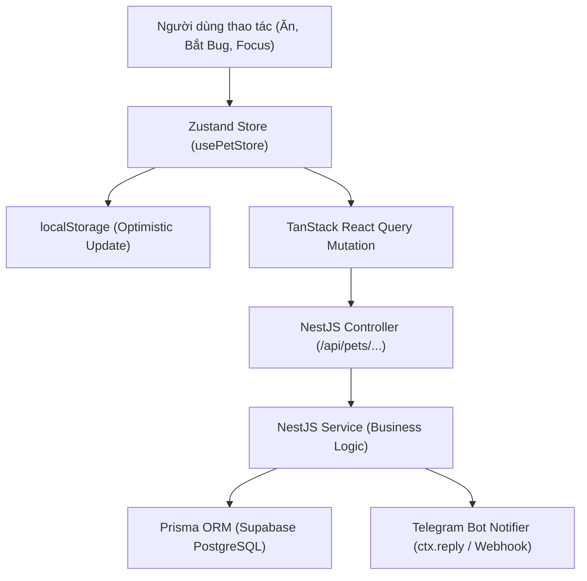

# DevGotchi System Analysis & Architectural Blueprint

Use this skill to conduct rigorous requirement analysis and architectural design before writing code in DevGotchi.

---

## 🎯 1. Phân Tích Nghiệp Vụ & Cân Bằng Game (Game Balancing Analysis)

Mỗi tính năng mới trong DevGotchi đều phải được phân tích qua 4 lăng kính cân bằng:

### A. Động Lực Người Dùng (User Motivation)
* **Casual vs. Hardcore:** Tính năng này phục vụ người dùng muốn giải trí nhanh (30s mini-game, uống nước, vuốt ve) hay người dùng muốn tập trung làm việc (25m Pomodoro)?
* **Rào cản gia nhập (Barrier to Entry):** Thú cưng có bị trừng phạt quá nặng nếu người dùng bận việc không mở app không? (Nguyên tắc: Hunger giảm tối đa 48h về 0, không bao giờ để pet "chết" vĩnh viễn).

### B. Công Thức & Chỉ Số Cân Bằng (Formulas Matrix)
* **Độ đói (Hunger 0–100):** Giảm 5 điểm mỗi 2.4 giờ (100 điểm = 48 giờ).
* **Năng lượng (Energy 0–100):** Nạp qua `/sleep` (100%), đồ ăn (Donut +25, Bánh cá +15), Pomodoro break (+15).
* **Hạnh phúc (Happiness 0–100):** Món khoái khẩu (+15 bonus), nựng/poke (+3, cooldown 30s).
* **Kinh nghiệm (EXP & Level):**
  $$\text{Level } 1 \to 2 = 100 \text{ EXP}; \quad \text{maxExp}_{n} = \text{round}(\text{maxExp}_{n-1} \times 1.35)$$

---

## 🏛️ 2. Phân Tích Kiến Trúc & Đồng Bộ Trạng Thái (Architecture & State Sync)

Đánh giá luồng dữ liệu 3 tầng (Offline LocalStorage $\leftrightarrow$ Client State $\leftrightarrow$ Server Database):

### Checklist Phân Tích Dữ Liệu:
1. **Schema Impact:** Có cần thêm bảng mới hay trường mới trong `prisma/schema.prisma` không? Có vi phạm Zero-Breaking-Change không?
2. **DTO Validation:** Có cần tạo DTO mới với `class-validator` không?
3. **Offline Fallback:** Nếu mất mạng hoặc backend tạm ngừng, giao diện người dùng có hoạt động trơn tru bằng `localStorage` không?
4. **Bot Command Parity:** Tính năng này trên Web App có cần lệnh tương ứng trên Telegram Bot không?

---

## 📋 3. Quy Trình Đầu Ra Của Bước Phân Tích (Deliverables)

Trước khi bắt tay vào code bất kỳ tính năng phức tạp nào, lập tài liệu phân tích gồm:
1. **Mục tiêu tính năng & Giá trị mang lại** cho lập trình viên.
2. **User Flow & Wireframe logic** (các màn hình/tab chịu ảnh hưởng).
3. **Danh sách API Endpoints** (Method, Path, Request Body, Response).
4. **Phân tích rủi ro & giải pháp phòng ngừa** (Breaking changes, Memory leak, Lag 3D).
